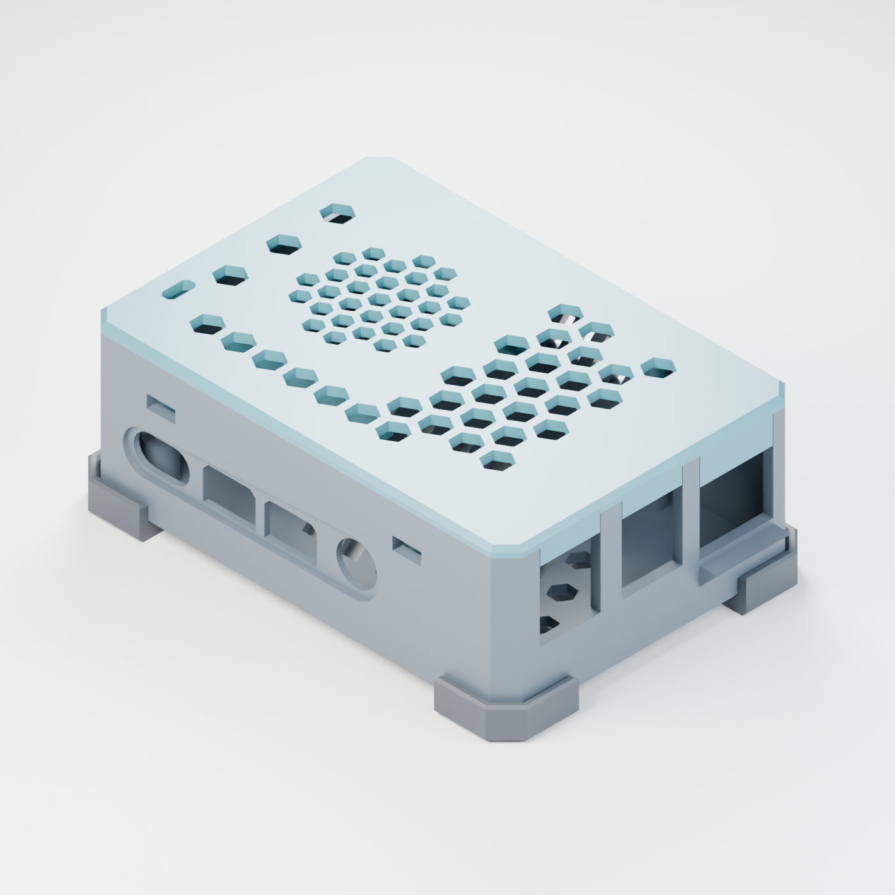
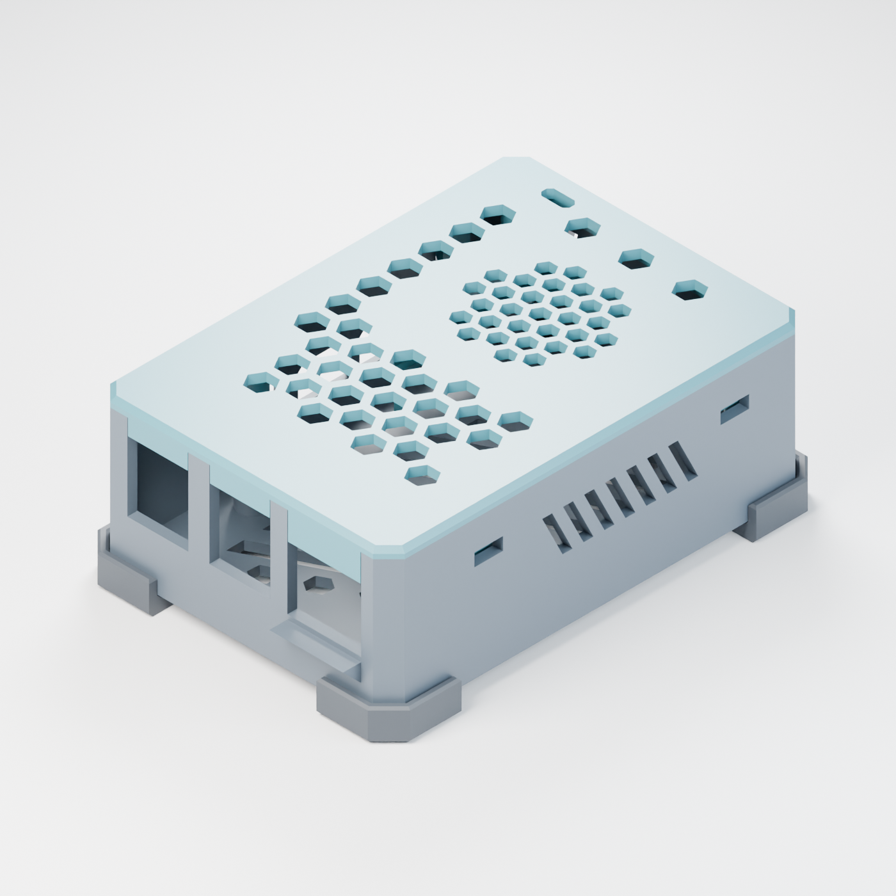
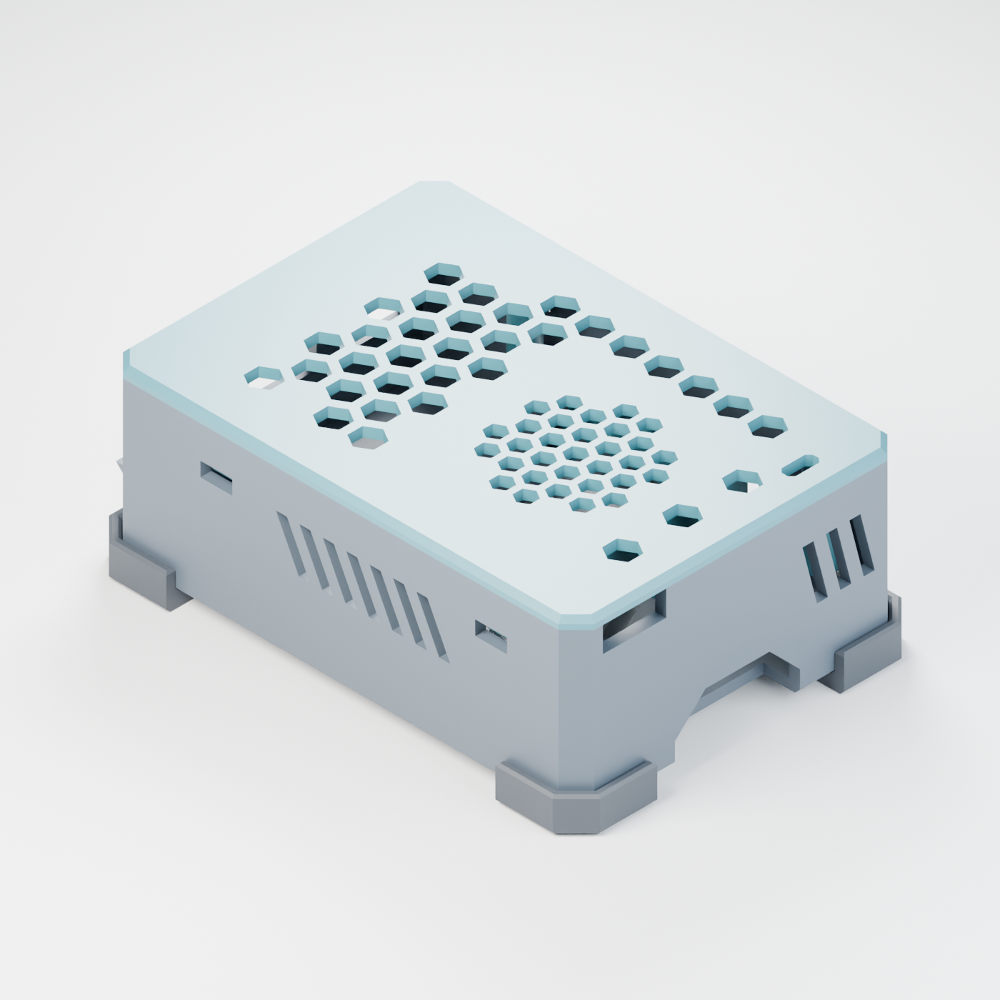
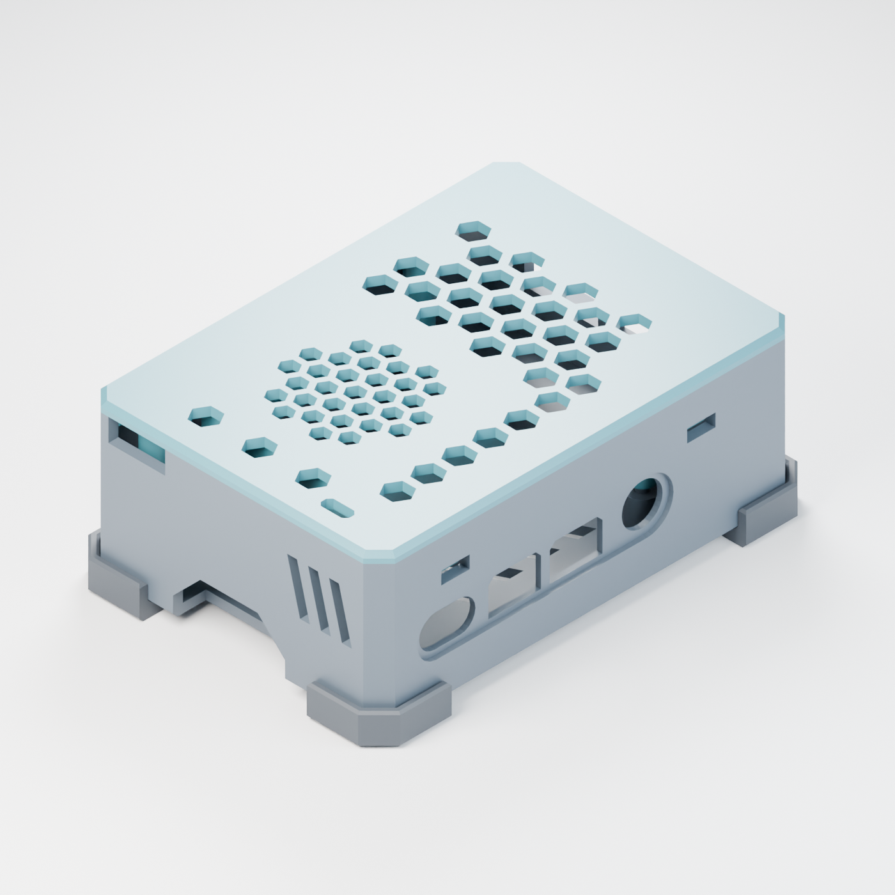
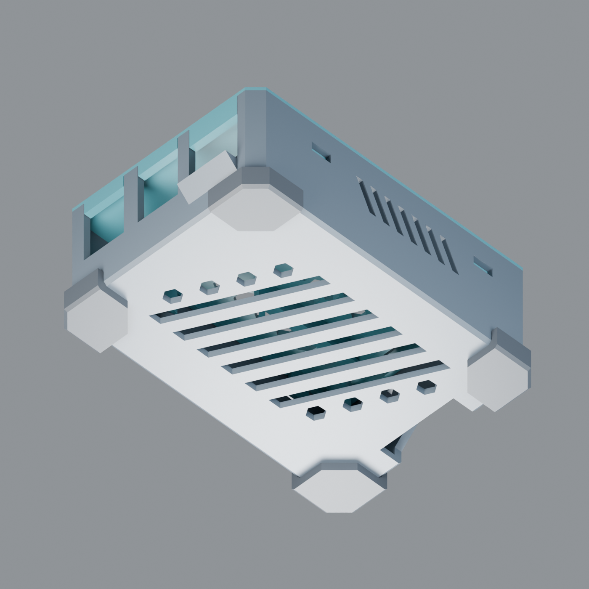
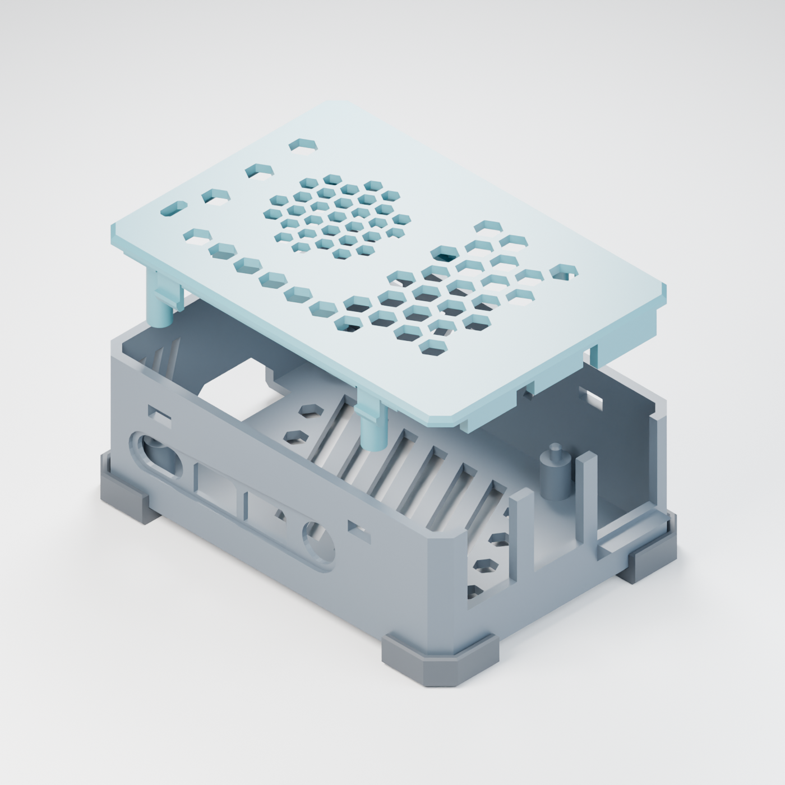

# Kontur Soty

**Design ID:** KNT-SOTY-RPI4B · **Version:** v01

**Designer:** Maxim Bezverhnii · [Email](mailto:offmonreall@gmail.com) · [@offmonreal](https://github.com/offmonreal)

Kontur Soty is a snap-fit enclosure designed for the Raspberry Pi 4 Model B. It combines chamfered corners with a honeycomb lid and four clip-on feet that keep the bottom vents clear of the desk.

- Snap-fit lid and locating pins for the board.
- Ventilation through the lid, side walls and base.
- Screwless slide-in mount for a 30 × 30 × 7 mm exhaust fan.
- Ethernet plug support, rear GPIO cable exit and an opening above the status LEDs.

| Front left | Front right |
| --- | --- |
|  |  |

| Rear left | Rear right |
| --- | --- |
|  |  |

| Underside | Lid lifted |
| --- | --- |
|  |  |

## Source archive timestamp

The OpenTimestamps proof for the private build123d source archive `KNT-SOTY-RPI4B-v01-source.zip` was verified against Bitcoin mainnet block **975221** (block date: **2026-11-09 UTC**).

**Bitcoin block hash:** `0000000000000000000042388ca3193dde8925d859410b4490d7afeec9c25014`

**SHA-256:** `8d59314d035ecd876144f0bf759490900ed02bf4ed8624aa721c31aacf837176`

## License

© 2026 Maxim Bezverhnii. Individuals may keep the renders and make the case for their own private, noncommercial use. Commercial use, paid printing, sale and redistribution require separate written permission. See the [Kontur Soty Personal Use License](LICENSE.md).
